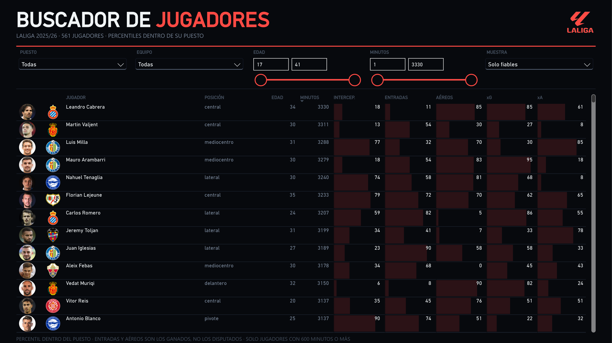
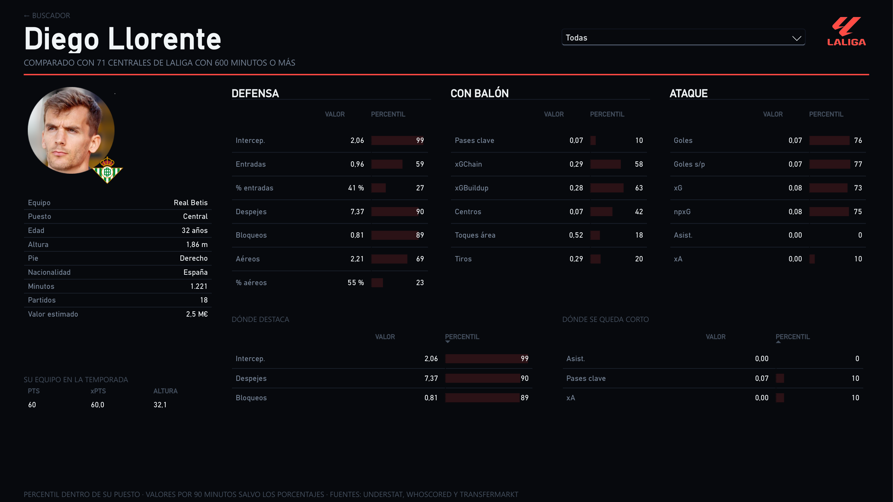
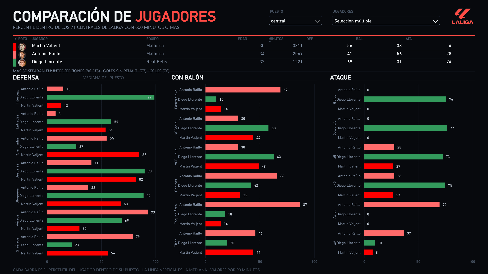
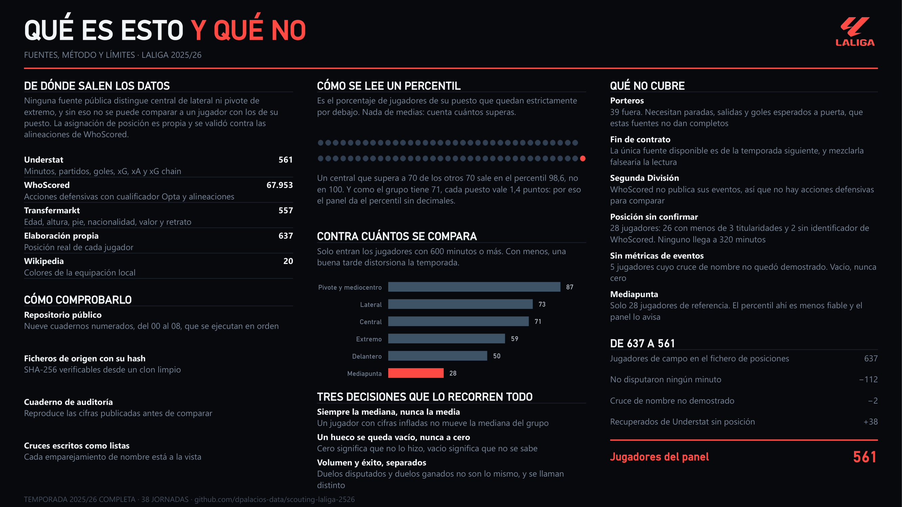

# Scouting LaLiga 2025/26

Panel de scouting en Power BI de los 561 jugadores de campo de LaLiga 2025/26: cada jugador comparado con los de
su puesto, en percentiles calculados sobre un modelo de datos propio y comprobable.

## El panel



**Buscador.** Abre con la muestra en «Solo fiables»: los jugadores con 600 minutos o más y la posición confirmada.
Por debajo de esa cifra, un percentil se apoya en pocas acciones y una buena tarde lo coloca arriba del todo; si
la tabla abriera con todos, el primer vistazo premiaría el ruido. Los demás siguen a un clic, y los que no son
fiables nunca reciben un percentil que parezca comparable.



**Ficha.** Cada métrica lleva el valor por 90 minutos y el percentil a la vez, porque ninguno se basta solo: 2,06
intercepciones no dicen si es mucho para un central, y un percentil 99 no dice si la ventaja es grande o mínima.
El subtítulo dice contra cuántos se compara («71 centrales») porque un percentil sin denominador no se puede
pesar: no vale lo mismo ser el mejor de 71 que de 28. Abre con Diego Llorente, el fichaje que propone el TFM.



**Comparación.** El puesto es de selección única y filtra el selector de jugadores, así que no se pueden mezclar
puestos. Un percentil es una posición dentro de un grupo: el 80 de un central y el 80 de un extremo están medidos
contra poblaciones distintas, y ponerlos en la misma barra no significaría nada. Abre con los tres centrales del
TFM: Llorente, Valjent y Raíllo.



**Método.** Un panel que solo enseña lo que tiene invita a leer los huecos como ceros. La página dice qué no
cubre (los porteros, los 28 sin posición confirmada, los 5 sin eventos, la muestra corta de mediapunta) y de
dónde sale cada número, porque saber dónde acaba el dato es lo que permite fiarse de lo que sí está.

## Cómo abrirlo

1. Clona el repositorio y abre `powerbi/scouting-laliga-2526.pbip` con Power BI Desktop (Windows).
2. Pulsa **Inicio → Actualizar**. El modelo lee los CSV de `data/modelo/` directamente de este repositorio en
   GitHub, así que necesita conexión; la caché local de Power BI no se versiona y, sin actualizar, puede enseñar
   datos de una versión anterior.

Las cuatro páginas se generan con los scripts de `powerbi/` (`generar_buscador.py`, `generar_ficha.py`,
`generar_comparacion.py` y `generar_metodo.py`), con Power BI cerrado. Si se guarda desde Power BI, hay que llevar
a los scripts lo que haya cambiado antes de volver a ejecutarlos.

Es un proyecto separado de mi TFM sobre el descenso del RCD Mallorca
([analisis-mallorca-2025-26](https://github.com/dpalacios-data/analisis-mallorca-2025-26)), del que reutiliza los
datos ya procesados. El TFM no se modifica.

---

## De dónde vienen los datos

| Fuente | Qué aporta |
|---|---|
| **Understat** | Minutos, partidos, goles, xG, asistencias, xA, tiros, pases clave, xGChain y xGBuildup de cada jugador. Puntos y puntos esperados de cada equipo |
| **Eventos Opta de WhoScored** | Alineaciones con el identificador de cada jugador, y acciones del partido con su resultado: entradas intentadas y exitosas, intercepciones, despejes, pases bloqueados, duelos aéreos disputados y ganados, centros y toques en el área |
| **Fichero propio de posiciones** | La posición de 637 jugadores, asignada a mano y validada en el TFM contra las alineaciones de WhoScored |

En el TFM también usé FBref, pero ninguna columna de este modelo sale de FBref.

Además: **Transfermarkt** (edad, altura, pie, nacionalidad, valor de mercado estimado y retrato) y **Wikipedia**
(colores de la equipación local). Ver [Escudos, retratos y colores](#escudos-retratos-y-colores).

En el TFM también usé FBref, pero ninguna columna de este modelo sale de FBref.

## Método

```
dim_equipo ──┐                 ┌── hechos_jugador
             ├── dim_jugador ──┼── hechos_metrica ── dim_metrica
dim_posicion ┘                 └── hechos_ficha
```

| Tabla | Filas | Contenido |
|---|---|---|
| `dim_equipo` | 20 | equipo (nombre de cruce) y `nombre_equipo` (para mostrar), altura defensiva, puntos, puntos esperados, escudo, colores de la camiseta y tres grados de color para la Comparación |
| `dim_posicion` | 9 | posición y grupo de comparación |
| `dim_jugador` | 561 | jugador, equipo, posición, minutos, partidos, de dónde sale su posición, edad, altura, pie, nacionalidad, valor de mercado estimado, url de su retrato y `color_jugador` |
| `hechos_jugador` | 561 | 19 métricas por 90 minutos y 2 porcentajes de éxito, con su percentil por grupo, `tiene_eventos`, `percentil_fiable`, `n_grupo_referencia` y `muestra_reducida`. Alimenta el Buscador |
| `dim_metrica` | 21 | cada métrica con su nombre, nombre corto, bloque (defensa, con balón, ataque), orden y unidad |
| `hechos_metrica` | 11.781 | las mismas métricas en formato largo: una fila por jugador y métrica, con valor y percentil. Alimenta la Ficha y la Comparación |
| `hechos_ficha` | 5.049 | los datos del jugador como pares atributo-valor, ya formateados como texto para la Ficha |

**Claves.** Todas las claves son numéricas y propias. La clave del jugador nunca es el nombre: hay dos jugadores
que se llaman David López, uno en el Mallorca y otro en el Girona. Los eventos de Opta se cruzan por el
identificador de WhoScored, no por nombre. Así los homónimos no se mezclan, y los traspasados suman los eventos
de sus dos clubes.

**Percentiles.**

- Se calculan dentro del grupo de posición, contra los jugadores de ese grupo con **600 minutos o más**.
- Fórmula: % del grupo de referencia con un valor estrictamente menor. Ningún jugador del grupo de referencia
  llega a 100: el mejor de los 71 centrales sale en 98,59.
- Los jugadores con menos de 600 minutos tienen percentil, pero con `percentil_fiable` en falso, y el panel lo
  avisa.
- **368 jugadores** tienen percentil fiable.
- Los resúmenes por bloque usan la **mediana** de los percentiles, nunca la media.
- Un dato que falta se queda **vacío, nunca a cero**: cero significa "no hizo la acción".

**Diferencias con el TFM.** Los percentiles de este proyecto no coinciden con los del TFM para los mismos
jugadores, y es lo esperado: el grupo de centrales pasa de 65 a 71 jugadores, el cruce de eventos es por
identificador, y las entradas y los duelos aéreos separan volumen y éxito. El
[diccionario de datos](docs/diccionario_datos.md) explica cada diferencia.

## Qué jugadores cubre

```
  jugadores en el fichero de posiciones           637
- no jugaron                                      112   data/sin_minutos.csv
- descartados por cruce dudoso                      2   data/cruces_descartados.csv
= jugadores del fichero de posiciones que entran  523
+ jugadores de campo recuperados de Understat      38
= total de jugadores del modelo                   561

  (aparte) porteros excluidos                      39
  comprobación: 561 + 39 = 600 jugadores en Understat
```

- **No jugaron (112):** están en el fichero de posiciones, pero no aparecen en Understat con ningún nombre
  parecido ni tienen un solo evento de Opta. La lista está en `data/sin_minutos.csv`.
- **Descartados por cruce dudoso (2):** Carlos Protesoni y Yago Santiago. Su posible pareja en Understat (Carlos
  Benavídez y Yago Alonso) solo comparte el nombre de pila. Esas dos filas de Understat entran en el modelo con
  su propio nombre, sin posición confirmada y sin eventos.

### Cómo se cruzó cada jugador

| Cruce | Jugadores |
|---|---|
| Directos: los cruzaba ya el TFM | 466 |
| Recuperados por nombre, eventos de Opta (estaban en el TFM con los eventos vacíos) | 15 |
| Recuperados por nombre, posiciones-Understat | 36 |
| Traspasados en invierno: Understat los pone en su club anterior | 6 |
| Recuperados por grafía: jugadores de Understat sin posición, con otra grafía en WhoScored | 2 |
| Recuperados de Understat sin posición | 36 |
| **Total** | **561** |

Todos los recuperados se comprobaron con el mismo equipo y los mismos partidos en las dos fuentes, y se
confirmaron a mano. Cada cruce está en `data/mapa_nombres.csv`, con el nombre del jugador en cada fuente.

### Posiciones

- **523** jugadores tienen la posición del fichero propio.
- **38** jugadores tienen la posición deducida de sus titularidades en las alineaciones de WhoScored:
  - **10** están confirmados.
  - **28** siguen **sin posición confirmada**: 26 con menos de 3 titularidades y 2 sin identificador de
    WhoScored. No tienen percentil y ninguno llega a 320 minutos.

## Límites

- **Porteros (39), fuera.** Un portero no se mide con intercepciones ni duelos aéreos: necesita paradas,
  salidas y goles esperados a puerta, y esos datos no los tengo completos. El panel lo dice en la página Método.
- **5 jugadores sin métricas de eventos** (`tiene_eventos` = falso), porque su cruce con WhoScored es dudoso:
  Carlos Benavídez, Yago Alonso, Adam El Mokhtari, Sergio Lozano y Rubén Iranzo. Todos tienen menos de 600
  minutos. Sus métricas de Opta están vacías, nunca a cero.
- **28 jugadores sin posición confirmada**, en el grupo `sin_confirmar`, sin percentil (ver arriba).
- **Mediapunta tiene solo 28 jugadores de referencia.** El modelo lo marca con `muestra_reducida` y el panel lo
  avisa.
- **Sin fecha de fin de contrato:** la única fuente disponible es de la temporada siguiente.
- **Sin Segunda División:** WhoScored no publica sus eventos.

## Escudos, retratos y colores

**Escudos.** Los 20 están en `images/escudos/`, con el nombre de fichero que usa `dim_equipo.escudo`: PNG con
transparencia, 128 × 128 px y el mismo margen interior. El origen de cada uno está en `data/escudos.csv`.

Los 20 están versionados, porque el panel los carga por su dirección pública en este repositorio
(`dim_equipo.url_escudo`): sin fichero en el repositorio no hay url pública, y el escudo es lo que identifica al
equipo en todo el panel.

**Los escudos son marcas registradas de sus clubes.** Se usan solo con fines identificativos, en un proyecto
académico sin ánimo de lucro. Cada uno tiene su url de origen y su fecha de descarga en `data/escudos.csv`.

- 17 se descargaron de la web oficial de cada club.
- 3 vienen de Wikimedia Commons (propiedad P154 de Wikidata), con licencia libre:

| Escudo | Licencia | Autor en Commons | Fichero |
|---|---|---|---|
| Barcelona | CC0 | HAMDANI 72 | [Football Club Barcelona Color Update.png](https://commons.wikimedia.org/wiki/File:Football_Club_Barcelona_Color_Update.png) |
| Celta | CC BY-SA 3.0 | Elisardojm, a partir de ficheros de Madboy74, HansenBCN y WarX | [Escudo RC Celta de Vigo.svg](https://commons.wikimedia.org/wiki/File:Escudo_RC_Celta_de_Vigo.svg) |
| Getafe | CC BY-SA 4.0 | Yawen | [Getafe CF Logo.png](https://commons.wikimedia.org/wiki/File:Getafe_CF_Logo.png) |

Estos tres están reducidos a 128 × 128 px respecto al original.

**Colores.** `dim_equipo.color_primario` y `color_secundario` son los dos colores de la camiseta de la primera
equipación 2025/26, medidos sobre la plantilla de equipación de la ficha de cada club en la Wikipedia en inglés
(versión de cada artículo a 31 de mayo de 2026). El primario es el que no es blanco, porque el blanco solo
identifica al Real Madrid. Son colores aproximados de Wikipedia, no colores de marca oficiales.

**El color no identifica al equipo: lo hace el escudo.** Hay 7 equipos rojos y 5 azules, y varios comparten
exactamente el mismo `#ff0000`. En la página Comparación, cada jugador se pinta con el color de su club aclarado
hasta contrastar 3:1 con el fondo (`dim_jugador.color_jugador`), y dos jugadores del mismo club reciben grados
distintos (`dim_equipo.color_grado_1` a `_3`; el par más parecido, en el Celta, está a 15,7 de distancia
CIEDE2000). El detalle, con la revisión de cada artículo, está en el
[diccionario de datos](docs/diccionario_datos.md).

**Retratos de jugadores. Fuente: [Transfermarkt](https://www.transfermarkt.es).** Los retratos son de
Transfermarkt y de sus proveedores. Se alojan en este repositorio (`images/jugadores/`) recortados en círculo,
porque Power BI no recorta imágenes, para un panel académico sin ánimo de lucro. La url de origen de cada uno
está en `data/fotos_transfermarkt.csv`, y en `dim_jugador.url_foto_transfermarkt`. El pie de la Ficha cita la
fuente.

- **539 de 561** jugadores tienen retrato de Transfermarkt, y **367 de los 368** con percentil fiable. Se
  recortan en el cuaderno 08: círculo de 200 × 200 px centrado en la cara, con la cabeza entera. Lo que el
  círculo pide a los lados de la foto se rellena prolongando su borde y desenfocándolo.
- Los otros **22** tienen un retrato de iniciales generado en este proyecto (cuaderno 07): un círculo del mismo
  tamaño con el color primario de su equipo y sus iniciales. Son 18 que en Transfermarkt solo tienen la silueta
  genérica, 3 sin coincidencia y 1 con cruce dudoso.
- `dim_jugador.url_foto` apunta, para los 561, a su retrato en este repositorio, y `foto_origen` dice de dónde
  sale cada uno. Todos son PNG con las esquinas transparentes, de menos de 128 KB y con url de menos de 255
  caracteres, los límites de Tableau.

**Datos de scouting. Fuente: Transfermarkt.** De las mismas páginas de plantilla salen la fecha de nacimiento,
la altura, el pie, la nacionalidad y el valor de mercado de 557 de los 561 jugadores (descargadas el 16/11/2026).

- **La edad está calculada a 31 de mayo de 2026**, último día de la temporada, no a día de hoy.
- **`valor_mercado_tm` es una estimación de Transfermarkt, no un precio real** ni una cifra de traspaso.
- La fecha de fin de contrato no está en el modelo: no aparece en las páginas de plantilla descargadas.
- 4 jugadores no tienen ninguno de estos datos, porque no están emparejados con Transfermarkt: Carlos
  Benavídez, Yago Alonso, Adam El Mokhtari y Sergio Lozano.

**Fuente evaluada y descartada: Wikimedia Commons.** Antes se midió la cobertura de fotos con licencia libre en
Wikidata (cuaderno 04, `data/fotos_wikidata.csv`): 218 de 561 jugadores (38,9 %) y 174 de los 368 con percentil
fiable (47,3 %). Con menos de la mitad de cobertura se cambió de fuente.

## Reproducibilidad

- **El cuaderno 00 no se puede ejecutar desde fuera, porque los eventos de WhoScored no están versionados en
  ningún sitio.** Necesita `data/bruto/eventos_laliga_2526.parquet` (16 MB), que no está en este repositorio
  ni en el del TFM. Se generó en el cuaderno 01 del TFM a partir de los eventos de WhoScored descargados con la librería `soccerdata`. Su SHA-256 es
  `8bcb04eeacb42d93d242ca735e080a86475b9d57aa5ee82fa267d7f997989d61`.
- **El cuaderno 01 sí se puede ejecutar, porque todo lo que lee está en el repositorio.** Las acciones de Opta
  ya agregadas por jugador están versionadas en `data/eventos_por_jugador.csv`, y el resto son ficheros de
  `data/origen/` y de `data/`.
- **El cuaderno 02 también se puede ejecutar** con lo que hay en el repositorio.
- **El cuaderno 05 también se puede ejecutar sin conexión.** Lo que leyó de Wikipedia está versionado en
  `data/wikitexto_equipaciones.json`.
- **El cuaderno 06 no se puede ejecutar desde fuera sin volver a descargar** las 20 páginas de plantilla de
  Transfermarkt, que se guardan en `data/bruto/transfermarkt/` y no se versionan. Su resultado sí está
  versionado, en `data/fotos_transfermarkt.csv`.
- **Los cuadernos 03 y 04 necesitan conexión a internet.** El 03 descarga los escudos de Wikimedia Commons y de
  las webs oficiales de los clubes, que pueden cambiar de dirección. El 04 consulta Wikidata; guarda una caché
  local (`data/cache_wikidata.json`, unos 8 MB) que no se versiona.
- **Los scripts de `powerbi/`** se ejecutan desde el repositorio: escriben las páginas del informe, las medidas
  del modelo y la imagen de la página Método; no leen datos.

Los ficheros de origen se copiaron del TFM sin modificarlos. La tabla muestra los 16 primeros caracteres del
SHA-256 de cada uno; los completos están en `data/origen/SHA256SUMS`, y se comprueban con:

```bash
cd data/origen && sha256sum -c SHA256SUMS
```

| Fichero (`data/origen/`) | SHA-256 (inicio) | Uso |
|---|---|---|
| `posiciones_laliga_2526.csv` | `d49b47fc82e486a9` | posición de cada jugador |
| `jugadores_laliga_2526.csv` | `645e7c0730a694b3` | Understat: minutos, partidos y métricas |
| `alineaciones_laliga_2526.csv` | `a357179f0c5ae48e` | identificador de WhoScored y puesto en cada alineación |
| `metricas_jugadores_laliga_2526.csv` | `6b8ea02ab17baad5` | cruce posiciones-Understat del TFM y auditoría |
| `altura_defensiva_laliga_2526.csv` | `4bb0d9f3578c0e3b` | altura defensiva de cada equipo |
| `clasificacion_xpts_laliga_2526.csv` | `f6cbe1b0889644be` | puntos y puntos esperados |
| `disparos_laliga_2526_limpio.csv` | `23f52e01c5fe60b6` | solo auditoría (modelos del TFM) |
| `equipos_largo_laliga_2526.csv` | `4e7e92d08b5a9152` | solo auditoría (modelos del TFM) |

### Cuadernos

| Cuaderno | Qué hace | ¿Se puede ejecutar desde el repositorio? |
|---|---|---|
| `notebooks/00_cruces_nombres.ipynb` | Decide qué jugador es quién en cada fuente. Todas las decisiones de cruce están escritas como listas en el cuaderno. Genera los ficheros de `data/` | **no**: necesita los eventos de WhoScored, que no están versionados |
| `notebooks/01_modelo_datos.ipynb` | Construye el modelo de `data/modelo/`, imprime el cuadre y ejecuta las comprobaciones de calidad | sí |
| `notebooks/03_escudos.ipynb` | Descarga los 20 escudos, los normaliza a 128 × 128 px con el mismo margen y extrae su color dominante | con conexión a internet |
| `notebooks/04_fotos_wikidata.ipynb` | Mide qué jugadores tienen foto en Wikidata. No descarga ninguna imagen. Fuente descartada por cobertura | con conexión a internet |
| `notebooks/05_colores_equipacion.ipynb` | Mide los dos colores de la camiseta de cada equipo sobre la plantilla de equipación de Wikipedia y fija el color primario | sí |
| `notebooks/07_retratos_iniciales.ipynb` | Genera el retrato de iniciales, en círculo, de los jugadores sin retrato de Transfermarkt | sí, después del cuaderno 01 |
| `notebooks/08_retratos_recortados.ipynb` | Descarga los 539 retratos de Transfermarkt y los recorta en círculo centrado en la cara | **no** sin volver a descargar los retratos (el resultado está versionado) |
| `notebooks/06_fotos_transfermarkt.ipynb` | Empareja a los 561 jugadores con las plantillas de Transfermarkt y guarda la url de su retrato, sin descargar imágenes. Comprueba que las url responden y cumplen los límites de Tableau | **no** sin volver a descargar las plantillas |
| `notebooks/02_auditoria_cruce_eventos.ipynb` | Comprueba que el cruce por identificador reproduce las cifras de eventos publicadas en el TFM: 462 de 464 jugadores son idénticos. Identifica los dos que cambian (dos homónimos que el TFM sumaba al cruzar por nombre) y mide su efecto en los cálculos del TFM. Compara también volumen y éxito en duelos aéreos y entradas | sí |

Entorno: Python con pandas, numpy, pyarrow, unidecode, Pillow y scikit-learn 1.9.1 (la versión con la que el cuaderno 02
reproduce los modelos del TFM). Cada cuaderno se ejecuta desde la raíz del proyecto o desde `notebooks/`, con
rutas relativas. Las fórmulas, unidades y fuentes de cada columna están en
[docs/diccionario_datos.md](docs/diccionario_datos.md).

## Pendiente

- **Panel en Tableau** sobre el mismo modelo. Los retratos ya cumplen sus límites (menos de 128 KB y url de menos
  de 255 caracteres).
- **Filtros por percentil en el Buscador:** hoy filtra por puesto, equipo, edad, minutos y muestra; no por el
  percentil de una métrica.
